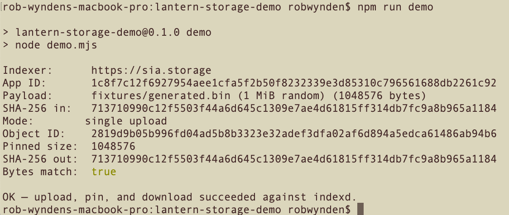

# Lantern Storage demo

Proof-of-work for the [Sia Foundation](https://sia.tech/grants) Lantern Storage grant: a Node.js script that **uploads, pins, and downloads** an object with the official JavaScript SDK against the Foundation indexer.

This is not the Ghost adapter. It only shows the storage path the adapter will use.

- SDK: [`@siafoundation/sia-storage`](https://www.npmjs.com/package/@siafoundation/sia-storage)
- Indexer: `https://sia.storage` (`indexd`)
- Runtime: Node.js 20+

## Live indexer run



## What it does

1. `npm run connect` — approve this app on `sia.storage` once and save a local app key.
2. `npm run demo` — upload ~1 MiB, `pinObject` on `indexd`, download, SHA-256 compare.

Optional: `npm run demo:packed` exercises `uploadPacked` (the small-file path Ghost thumbnails will use).

## Setup

```bash
git clone https://github.com/YOUR_ORG/lantern-storage-demo.git
cd lantern-storage-demo
npm install
node --version   # >= 20
```

### 1. Connect a storage account

`sia.storage` has a 50 GB free tier. First run needs a browser approval:

```bash
npm run connect
```

Open the printed URL, approve **Lantern Storage Demo**, then either paste your existing `sia.storage` recovery phrase or type `seed` to generate one.

This writes:

| File | Purpose | Secret? |
| --- | --- | --- |
| `.lantern-app-id` | Stable 32-byte app id (hex) | No |
| `.lantern-app-key` | App key for reconnect | **Yes — gitignored** |

Will not commit `.lantern-app-key` or any recovery phrase.

### 2. Upload / pin / download

```bash
npm run demo
```

Expected log shape:

```
Indexer:      https://sia.storage
App ID:       …
Payload:      fixtures/generated.bin (1 MiB random) (1048576 bytes)
SHA-256 in:   …
Mode:         single upload
Object ID:    …
Pinned size:  …
SHA-256 out:  …
Bytes match:  true

OK — upload, pin, and download succeeded against indexd.
```

(See posted screenshot in root folder)

On success it also writes `.lantern-last-object.json` (gitignored) with the object id for the grant thread.

## Layout

```
connect.mjs          first-run approval
demo.mjs             upload / pin / download
lib/app-meta.mjs     stable app id + indexer URL
fixtures/            optional sample.bin
```

Override the indexer with `SIA_INDEXER_URL` if you point at a self-hosted `indexd`.

## Grant context

This repo is the pre-proposal demo for **Lantern Storage**: a Ghost `ghost-storage-base` adapter on `@siafoundation/sia-storage` + `indexd`. See the companion proposal markdown.

## License

MIT
